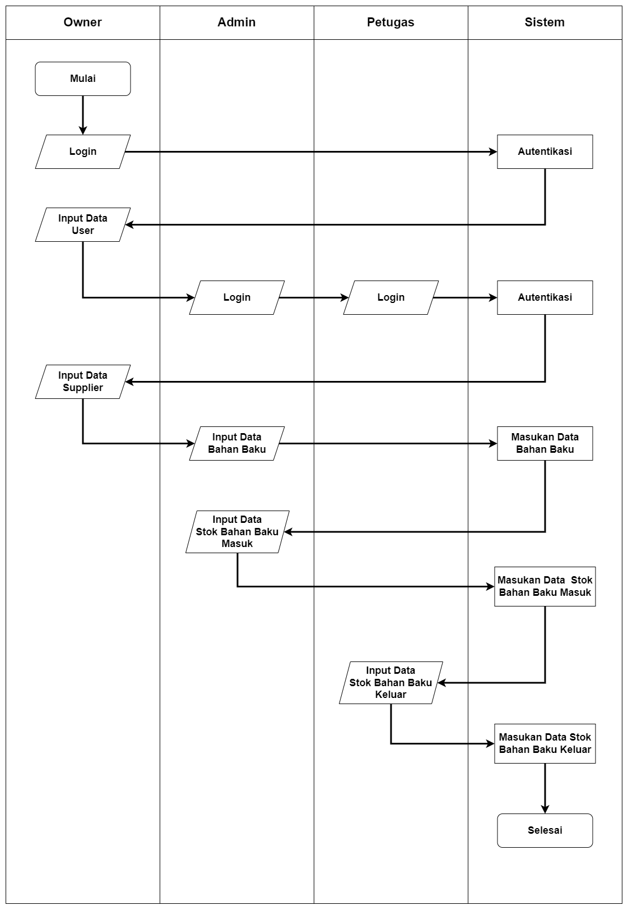
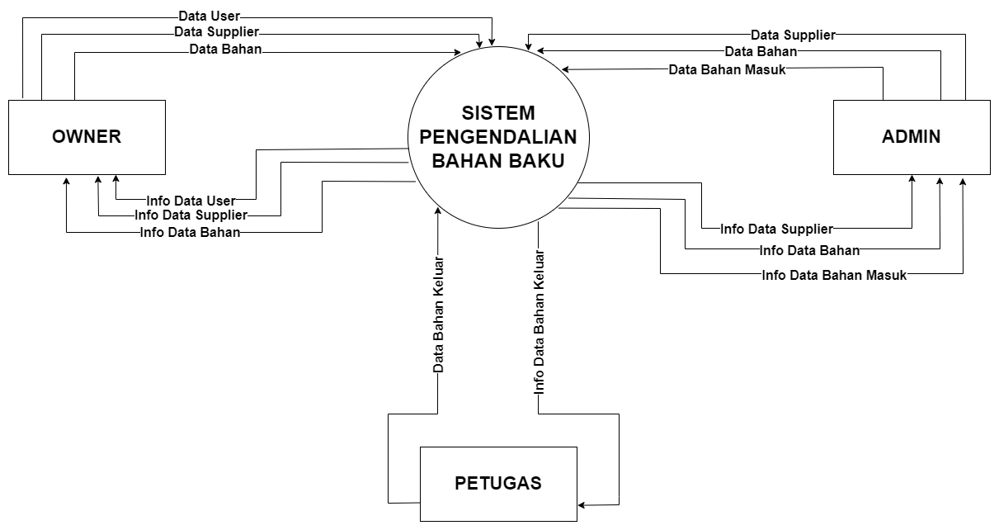
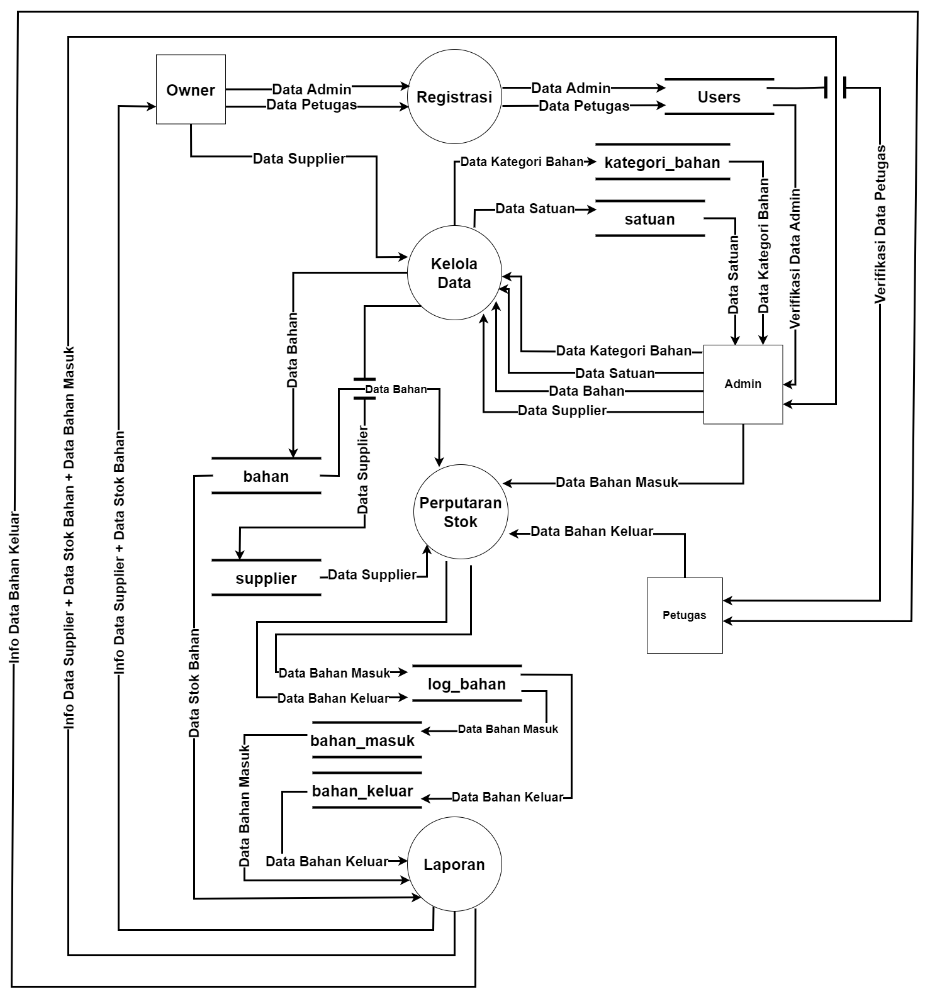
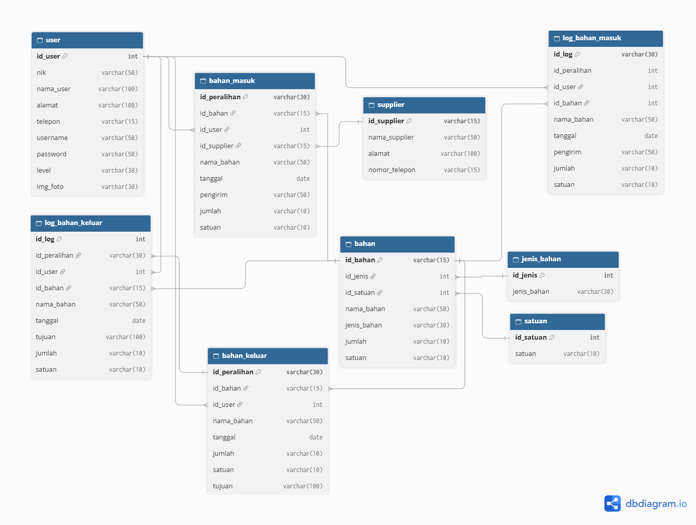

# Pemodelan Sistem dan Arsitektur (System Modeling)

## Sistem Pengendalian Bahan Baku FnB

Dokumen ini memuat penjelasan teknis dan perancangan alur kerja, aliran data, serta basis data dari sistem pengendalian bahan baku kafe berbasis web yang dirancang untuk mengelola sirkulasi stok bahan baku secara akurat dan transparan.

---

## Flowchart Sistem
Diagram yang menggambarkan alur kerja secara berurutan berdasarkan hak akses pengguna (Owner/Superadmin, Admin, dan Petugas) mulai dari proses autentikasi hingga pemantauan operasional.

Keterangan Alur:

- **Autentikasi Pengguna:** Pengguna memasukkan *username* dan *password* pada halaman login untuk divalidasi sistem sesuai hak akses (*role*).
- **Pengelolaan Data & Sirkulasi Stok:** Admin bertugas mengelola data supplier serta mencatat transaksi bahan masuk; Petugas (*Head Bar*) fokus mencatat transaksi pengeluaran bahan untuk keperluan produksi.
- **Monitoring & Manajemen Hak Akses:** Owner/Superadmin memiliki kewenangan penuh untuk membuat hak akses pengguna serta memantau keseluruhan log sirkulasi bahan secara terpusat.

## Diagram Konteks
Diagram yang menggambarkan batasan sistem secara makro dan interaksinya dengan entitas eksternal dalam pertukaran data operasional bahan baku.

Entitas yang terlibat :
- **Owner (Superadmin):** Mengelola dan memberikan hak akses pengguna, serta menerima rekapitulasi laporan sirkulasi bahan.
- **Admin:** Memberikan input data master, data supplier, serta pencatatan transaksi bahan masuk ke dalam sistem.
- **Petugas:** Memberikan input pencatatan transaksi bahan keluar untuk produksi serta menerima informasi terkait penggunaan bahan.

## Data Flow Diagram (DFD) Level 1
Diagram yang merinci dekomposisi proses fungsional utama pada sistem pengendalian bahan baku beserta penyimpanan data (*data store*) yang terlibat.

Aktivitas / proses yang terlibat :
- **Proses 1.0 (Registrasi):** Mengelola hak akses admin dan serta data pengguna (`user`).
- **Proses 2.0 (Kelola Data):** Mengelola master data yang mencakup data bahan baku, kategori bahan, satuan, dan data supplier (`bahan`, `kategori_bahan`, `satuan`, `supplier`).
- **Proses 3.0 (Perputaran Stok):** Mengelola transaksi alur stok bahan masuk dan bahan keluar, serta mencatat riwayat perubahan log stok bahan (`bahan_masuk`, `bahan_keluar`, `log_bahan`, `bahan`, `supplier`).
- **Proses 4.0 (Laporan):** Menyajikan informasi laporan yang mencakup data supplier, stok bahan, data bahan masuk, serta data bahan keluar untuk kebutuhan Owner (`supplier`, `bahan`, `bahan_masuk`, `bahan_keluar`).

## Relasi Basis Data
Perancangan struktur skema basis data relasional yang menormalisasi tabel-tabel utama menggunakan *Primary Key* dan *Foreign Key* untuk menjamin integritas data audit transaksi harian.

Tabel Utama yang Digunakan:

- **user:** Menyimpan data informasi akun, NIP, kredensial login, dan tingkat hak akses (*level*).
- **bahan, jenis_bahan & satuan:** Menyimpan master data bahan baku beserta kategori jenis dan satuan ukur.
- **supplier:** Menyimpan data vendor atau pemasok bahan baku.
- **bahan_masuk:** Mencatat transaksi pasokan atau penerimaan bahan masuk dari supplier.
- **bahan_keluar:** Mencatat transaksi pengeluaran bahan baku untuk keperluan produksi kafe.
- **log_bahan:** Menyimpan rekapitulasi riwayat log audit perputaran stok secara berkala.
